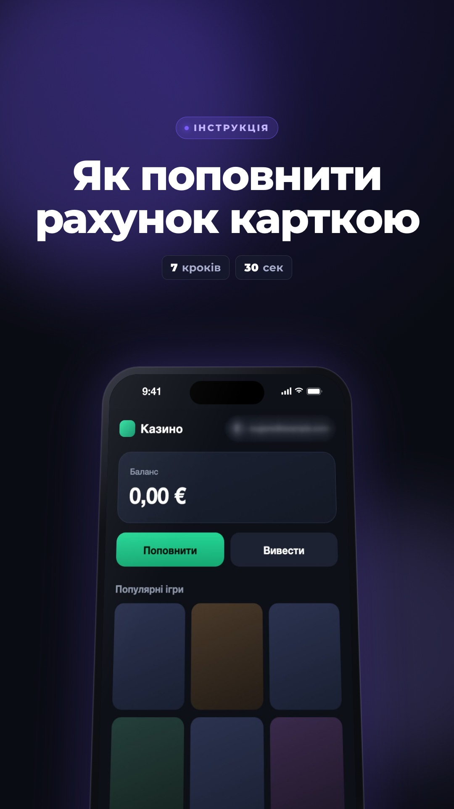

# show: видеоинструкция для игроков по ссылке на сайт

Скилл для Claude Code. Даете ссылку на сайт и пишете словами, что нажать. Через пару минут получаете готовый вертикальный ролик для игрока: как пополнить счет, найти игру, активировать бонус, вывести выигрыш. Ролик можно сразу отправлять в чат поддержки, в рассылку или в базу знаний.

[](examples/video/deposit-card.uk.mp4)

Пример: [examples/video/deposit-card.uk.mp4](examples/video/deposit-card.uk.mp4), 28 секунд. Кабинет в нем вымышленный.

## Что получаете

- **Экран телефона целиком.** Сайт открывается в мобильной версии с экраном iPhone 15, в двойной четкости. Статус-бар, нижнее меню и края видны, ничего не обрезано.
- **Точные рамки.** Рамка шага берется прямо со страницы: точные границы кнопки и скругление ее углов. Рамка не съезжает на соседние элементы.
- **Проверенные нажатия.** Скрипт нажимает каждую кнопку и проверяет, что экран сменился. Если кнопка не нашлась или нажатие ничего не изменило, он останавливается со снимком экрана, а не делает кривой ролик.
- **Подписи шагов на ваших языках.** Названия кнопок в подписи совпадают с тем, что на экране. Обращение к игроку на ты или на вы.
- **Ваш стиль.** Цвета, логотип и шрифты бренда в заставке, подписях и финале.
- **Готовые тексты.** К ролику: шаги текстом, вопросы игроков, на которые он отвечает, и готовый ответ оператора поддержки.

Ролик 1080x1920, 60 кадров в секунду, на каждый язык свой файл, плюс обложка.

## Как это работает

1. Вы пишете сценарий словами: "внизу нажми Слоти, потом Больше рядом с Все провайдеры".
2. Claude переводит его в шаги и запускает запись. Браузер на вашем компьютере открывает сайт как телефон, сам закрывает рекламные плашки, листает к нужному разделу и нажимает кнопки.
3. Загрузки страниц вырезаются, долгая прокрутка ускоряется.
4. Перед сборкой ролика Claude проверяет лист кадров: рамки, точки нажатия, края экрана, размытие. Ролик собирается только после чистой проверки.

Если на экране две одинаковые кнопки, скрипт не угадывает, а останавливается и просит уточнить. Если раздел ниже экрана, он сам долистает до него отдельным шагом с подписью "Прокрути до ...".

## Вход в аккаунт: обычный и VIP

Многие сценарии видны только после входа: касса, бонусы, профиль, VIP-раздел. Для них нужен тестовый аккаунт.

1. Claude открывает отдельное окно Chrome с сайтом в мобильном виде.
2. Вы сами входите в тестовый аккаунт и закрываете окно. Пароль и коды видите только вы: скрипт их не вводит и не хранит.
3. Вход сохраняется в отдельной папке профиля, и дальше все записи идут в этом аккаунте. Для обычного и VIP-аккаунта две папки, так одни и те же сценарии снимаются для разных уровней.

Ваш основной профиль Chrome не используется: Chrome с версии 136 не дает управлять им из скрипта, а ваши куки и вкладки остаются нетронутыми.

## Безопасность и личные данные

- **Кнопки денег не нажимаются.** Оплату, вывод и ставку скрипт не нажимает никогда. Ролик заканчивается рамкой на такой кнопке: игрок видит, куда нажать, а деньги с тестового аккаунта не списываются.
- **Размытие до записи.** Почта, телефон, номер карты и маска "**** 1234", IBAN, ID игрока, поля почты, телефона и пароля размываются прямо на странице до того, как кадр попадает в запись. Что еще скрыть (имя, ник, баланс), задается списком.
- **Проверка человеком.** Размытие это страховка. Перед отправкой посмотрите лист проверки и ролик.
- **Все на вашем компьютере.** Записи, ролики и профили с входом лежат у вас. Скилл ничего никуда не загружает.
- Скрипт не регистрируется, не вводит личные и платежные данные, не принимает условия и возрастные окна, cookie только отклоняет.

## Установка

Нужны:

- Claude Code (в терминале, в десктопном приложении или в расширении для редактора);
- macOS или Linux;
- `python3`, `ffmpeg` и Google Chrome (подойдут Chromium и Edge). На Mac ffmpeg ставится командой `brew install ffmpeg`.

### Одна команда

```bash
git clone https://github.com/igamingsychov/show-igaming.git ~/.claude/skills/show
```

### Пусть Claude установит сам

Откройте Claude Code и вставьте:

```text
Установи скилл show из https://github.com/igamingsychov/show-igaming : склонируй репозиторий в ~/.claude/skills/show (если папка уже есть, спроси меня), проверь python3, ffmpeg и Chrome командой python3 ~/.claude/skills/show/scripts/show.py check и скажи, что мне написать для проверки.
```

### Проверка

Откройте новую сессию Claude Code и напишите:

```text
сделай демо-ролик скилла show
```

Claude поднимет тестовую страницу на вашем компьютере (вымышленный кабинет с почтой, ID, телефоном и картой), запишет сценарий пополнения и соберет ролик. На нем видно размытие и рамку на кнопке оплаты без нажатия.

Обновить: `git -C ~/.claude/skills/show pull`. Удалить: `rm -rf ~/.claude/skills/show`.

## Как пользоваться

- `сделай видеоинструкцию: как найти игру через поиск на https://ваш-сайт/uk, на ты`
- `видео для саппорта: как пополнить счет картой, тестовый VIP-аккаунт, украинский и русский`
- `покажи игроку, где раздел бонусов, сайт https://ваш-сайт, стиль бренда с сайта`

Для каждого языка интерфейса делается своя запись, чтобы подпись называла кнопку так, как она написана на экране. Запись занимает около минуты, сборка ролика около полутора минут на язык.

На выходе папка с `<сценарий>.<язык>.mp4`, обложкой `<сценарий>.<язык>.jpg`, шагами текстом `<сценарий>.steps.md` и карточкой `<сценарий>.card.json` (вопросы игроков, ответ оператора, дата записи).

## Свой стиль

Стиль задается файлом `brand.json`: цвета, логотип, шрифт текста и заголовков, обращение на ты или на вы, тексты заставки и финала. Claude может снять цвета, логотип и шрифты с вашего сайта. Пример светлой темы: [examples/brand-light/brand.json](examples/brand-light/brand.json).

## Ограничения

- Нужна мобильная версия сайта.
- Проверку на робота скрипт не проходит. Ее проходите вы в окне входа, и запись идет в том же профиле.
- Если сайт закрыт для вашей страны, запись нужно запускать из страны, где он открывается.
- Формы платежных систем, которые открываются во фрейме другого сайта, автоматически не размываются. Для них Claude ставит зоны размытия вручную, это видно на листе проверки.
- Windows пока не поддерживается.

## Лицензия

MIT, [LICENSE](LICENSE). Шрифт Montserrat в `assets/fonts` и шрифт Lora в примере светлой темы распространяются по SIL Open Font License 1.1, тексты лицензий лежат рядом со шрифтами.

Автор: Yevhen Sychov.

---

## English

**show** is a Claude Code skill that turns a website link and steps written in plain words into a finished vertical tutorial video for players: how to deposit, find a game, claim a bonus or withdraw.

- The site opens in its mobile version on an iPhone 15 screen at 2x. The whole screen is visible, nothing is cropped.
- Highlight frames come from the page itself: exact element bounds and corner radius.
- Every tap is verified: if a button is missing or a tap changes nothing, the recorder stops with a screenshot instead of making a broken video.
- Step captions in your languages, your brand colours, logo and fonts, plus step text, player questions and a ready support reply.
- Logged-in scenarios (regular or VIP test account): Claude opens a separate Chrome window, you sign in yourself and close it. The login stays in a separate profile folder; your main Chrome profile is never used.
- Payment, withdrawal and bet buttons are never pressed: the video ends with a frame on that button. Emails, phones, card numbers, IBANs and player IDs are blurred in the page before frames are captured.

Install:

```bash
git clone https://github.com/igamingsychov/show-igaming.git ~/.claude/skills/show
```

Requires macOS or Linux, `python3`, `ffmpeg` and Google Chrome (Chromium and Edge work too). Check: `python3 ~/.claude/skills/show/scripts/show.py check`, then ask Claude Code `make a demo video with the show skill`.
